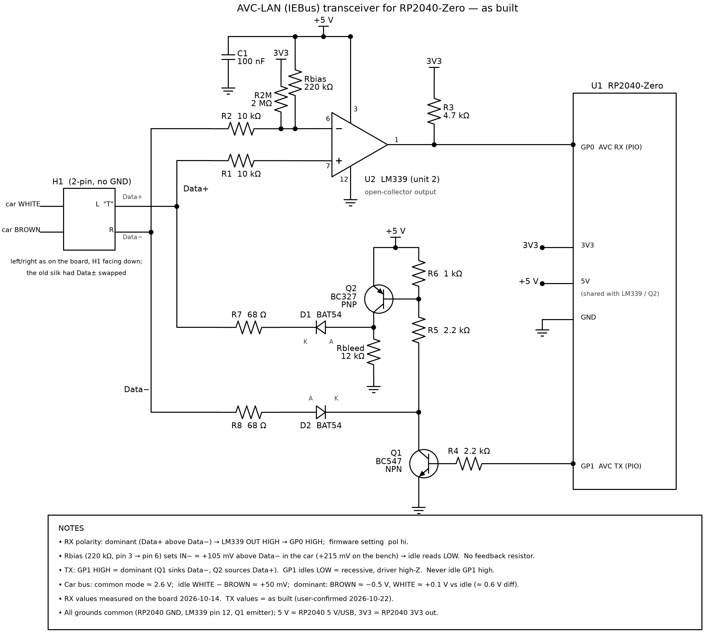
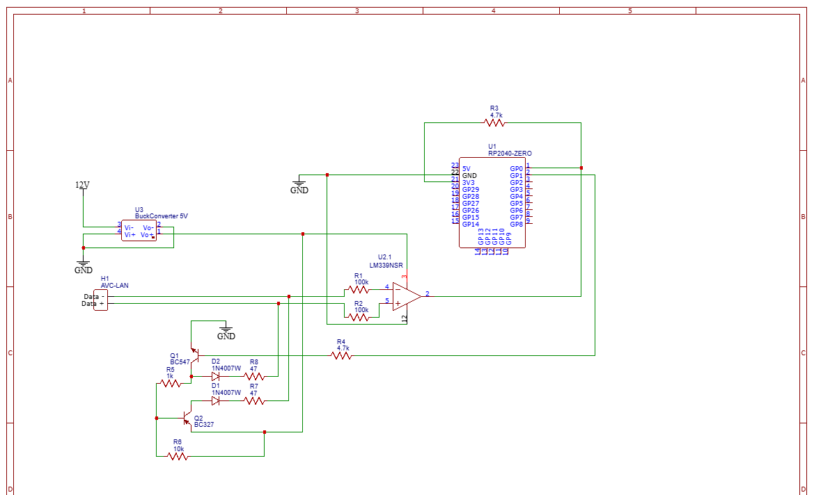
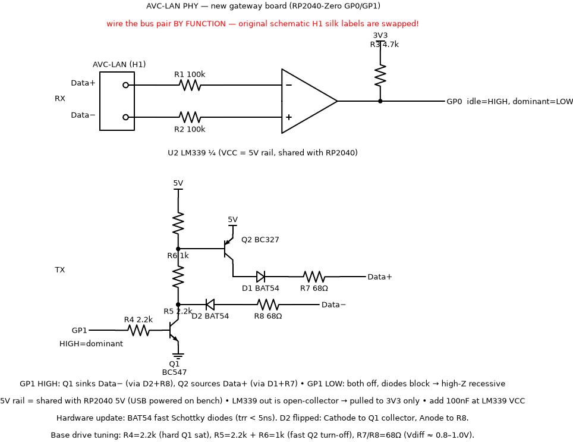

# Appendix A1. The AVC-LAN transceiver used for these captures

This is the author's own receiver/driver for an RP2040-Zero microcontroller board, documented
as built and as measured, mistakes included. Every capture in this repository was made with it:

- 2026-10-07 to 2026-10-12: receive only. Transmitting partly worked, with the board in the
  states described in A1.4.
- From 2026-10-14: receive and transmit, in the final configuration (A1.2).

The circuit uses cheap through-hole parts: an LM339 comparator, a BC547 and a BC327.



*Figure A1-1. The final configuration, verified in the car on 2026-10-14. Detail views:
[receiver](img/avclan_transceiver_rx.png) and [driver](img/avclan_transceiver_tx.png).*

### Component values (final configuration)

| Ref | Part / value | Function |
|---|---|---|
| U1 | RP2040-Zero | GP0 = RX, GP1 = TX |
| U2 | LM339 (unit 2: pins 6 / 7 / 1), VCC pin 3 = 5 V, GND pin 12 | receive comparator |
| R1 | 10 kΩ | Data+ → IN+ (pin 7) |
| R2 | 10 kΩ | Data− → IN− (pin 6) |
| Rb | 220 kΩ | IN− (pin 6) → +5 V: recessive bias, ≈ 105 mV in the car |
| R3 | 4.7 kΩ | comparator output pull-up to 3V3 → GP0 |
| (none) | — | no feedback / hysteresis resistor |
| R4 | 2.2 kΩ | GP1 → Q1 base |
| Q1 | BC547 (NPN) | sinks Data− during dominant |
| R5 | 2.2 kΩ | Q1 collector → Q2 base |
| R6 | 1 kΩ | Q2 base → +5 V (turn-off) |
| Q2 | BC327 (PNP) | sources Data+ during dominant |
| D1, D2 | BAT54 (or 1N4148W / BAS16) | fast blocking diodes; D2 cathode to Q1 collector |
| R7, R8 | 68 Ω | series drive resistors to Data+ / Data− |
| — | 12 kΩ, Q2 collector → GND | bleeder added during debugging (harmless) |
| — | 2 MΩ, 3V3 → pin 6 | left over from an earlier attempt (≈ +3.5 mV, irrelevant) |

## A1.1 Microcontroller pins

| Signal | RP2040-Zero pin | Level |
|---|---|---|
| RX (comparator output) | **GP0** | open-collector LM339 output, pulled up to **3V3** with 4.7 kΩ (never 5 V) |
| TX (driver input) | **GP1** | HIGH = drive dominant. It must idle LOW: a GP1 stuck high jams the bus |
| Ground | GND | common with the car's chassis ground. **Required**: with a floating ground (USB-only laptop ground) nothing decoded |
| Supply | 5 V | the LM339 and the TX driver run from the board's 5 V rail (from USB on the bench) |

The firmware times pulses in a PIO state machine (0.5 µs resolution on RX) and generates TX
pulse widths with a second PIO program. Firmware, host tools and their documentation are
published separately in this repository (see the README).

## A1.2 Final configuration (verified 2026-10-14)

### Receiver

```
Data+ (car white) ──R1 10k──► LM339 pin 7 (IN+)
Data− (car brown) ──R2 10k──► LM339 pin 6 (IN−) ◄──Rb 220k── LM339 pin 3 (+5 V)
LM339 pin 1 (OUT) ──R3 4.7k── 3V3 ;  pin 1 ──► GP0
LM339 pin 3 = +5 V, pin 12 = GND ; no feedback (hysteresis) resistor
firmware RX polarity: dominant = GP0 HIGH ("hi")
```

| Item | Value / behaviour |
|---|---|
| Comparator | LM339, **unit 2** (IN− = pin 6, IN+ = pin 7, OUT = pin 1) |
| Input resistors | R1 = R2 = 10 kΩ (measured 9.62 k / 9.87 k) |
| Threshold bias | **Rb = 220 kΩ from IN− (pin 6) to +5 V.** With 10 kΩ input resistors and the bus at ≈ 2.6 V it lifts IN− ≈ 105 mV above Data− in the car (≈ 215 mV on the bench with the lines at 0 V) |
| Idle | IN+ (Data+, ≈ +50 mV above Data−) stays below IN− (Data− + 105 mV), so OUT is low and **GP0 idles LOW** |
| Dominant | Data+ rises and Data− falls (≈ 0.6 V differential), so OUT is released and **GP0 goes HIGH**. Our own driver raising Data+ to ≈ 4.5 V does the same, so the receiver hears its own transmissions |
| Margin | the car's idle offset (≈ +50 mV) must stay below the ≈ 105 mV bias. A 150 kΩ bias (≈ 150 mV) would add margin if needed |
| Extra part from an earlier attempt | 2 MΩ from 3V3 to pin 6, still fitted. It adds only ≈ +3.5 mV and is irrelevant |

### Transmitter (dominant push-pull, recessive high-Z)

```
GP1 ──R4 2.2k──► Q1 base (BC547 NPN), Q1 emitter → GND
Q1 collector ──R5 2.2k──► Q2 base (BC327 PNP);  Q2 base ──R6 1k──► +5 V ; Q2 emitter → +5 V
Q2 collector ──► D1 (BAT54, anode at Q2) ──R7 68Ω──► Data+
Data− ──R8 68Ω──► D2 (BAT54, cathode at Q1 collector) ──► Q1 collector
Q2 collector ──12k──► GND   (bleeder, added during debugging, harmless)
```

- **GP1 HIGH**: Q1 saturates and sinks Data− through R8 and D2. Q1 also pulls Q2's base down
  through R5, so Q2 sources Data+ through D1 and R7. Measured into a 1 kΩ–1 kΩ–1 kΩ bench
  load: Data+ ≈ 4.55 V, Data− ≈ 0 V.
- **GP1 LOW**: both transistors are off and the diodes block, so the driver does not load the
  bus.
- The diodes must be fast (BAT54 Schottky, or 1N4148W/BAS16). The first board revision used
  1N4007W rectifiers; their reverse recovery smears 7 µs gaps. **D2's orientation matters**:
  cathode to Q1's collector. Reversed, Q1 cannot pull Data− down.
- Base values R4 2.2 k / R5 2.2 k / R6 1 k give hard saturation of Q1 and a fast turn-off of
  Q2. The first revision used 4.7 k / 1 k / 10 k, and Q2 released ≈ 2 µs late.

### Acceptance test (use before connecting to a car)

1. Bench, lines loaded (e.g. GND–2.2 k–Data+–120 Ω–Data−–2.2 k–GND). Read GP0 at idle, while
   GP1 is held HIGH, and after release. The result must be **idle / dominant / idle** (with
   the final configuration: 0, 1, 0). If all three readings are equal, the threshold bias is
   wrong or missing.
2. Transmit a frame and decode your own echo. The widths seen through the receiver were
   22 / 34 µs with gaps of 16 / 4 µs: the receiver delays edges by ≈ 2 µs at the bench swing.
3. In the car, with READY on: frames decode with 0 parity errors, and your own transmissions
   are echoed and ACKed.

A car that is switched off reads as permanently dominant ("stuck") on a powered receiver. Do
not interpret that as wiring polarity.

## A1.3 Scope and meter facts from the car (2026-10-14)

| Measurement | Result |
|---|---|
| Line levels with traffic (mean) | white (Data+) ≈ 2.75 V, brown (Data−) ≈ 2.45 V |
| Idle differential | white above brown by ≈ 0.05–0.1 V |
| Dominant excursion | brown (Data−) −0.5 V, white (Data+) +0.1 V |
| Car frame timing through the receiver | 20 / 34 / 170 µs dominant, 18 / 6 µs gaps; ≈ 1 µs receiver delay |
| Scope sanity | both channels must first read the same point: one channel read +50 mV high and misled a whole session. A ×10 probe (≈ 15 pF) on a comparator input delays the release edge by ≈ 5 µs |

## A1.4 History and lessons learned

The original design (first revision, Figure A1-2) looked correct on paper, but it never
received and transmitted reliably at the same time. These were the reasons, found one by one:



*Figure A1-2. First revision (2025). On this drawing, H1's "Data −"/"Data +" labels are
swapped relative to their electrical function, and the RX part shows 100 kΩ inputs with no
bias. The built board differed from it (see 3–5).*

1. **Label bug.** The schematic's connector labels were swapped. The pin the PNP sources
   during dominant is electrically Data+. Wire the pair **by function**: the line that pulses
   upward during traffic is Data+.
2. **Floating ground.** A tap powered only from a laptop over USB, with no car ground, decoded
   nothing. Tie the board's ground to the chassis.
3. **Zero-threshold comparator.** At idle the differential is only tens of millivolts, so a
   plain comparator rests on its offset. Half of the wiring combinations read permanent
   dominant: a "pinned" or "deaf" receiver. A deliberate bias towards recessive is
   **required**.
4. **Undocumented parts on the built board.** The board actually carried 10 kΩ input resistors
   (not 100 kΩ), a 470 kΩ feedback resistor from OUT to IN+, and a 220 kΩ resistor from pin 6
   to GND. In the car, the pull-down moved pin 6 ≈ 113 mV *below* its line, and the feedback
   latched the output by +17 / −52 mV. A 2 MΩ "bias" added from 3V3 in the meantime shifted
   the input by only ≈ 3.5 mV through 10 kΩ, so it did nothing. Together these made the receiver
   work in only one orientation, in which our own transmissions were invisible. Two other
   theories cost days before the parts were measured with the comparator out of its socket:
   a leaking driver transistor, and the board revision drawn in Figure A1-3.
5. **Fix.** Lift the 220 kΩ's ground end and connect it to +5 V (pin 3), so it becomes the
   recessive bias. Cut the 470 kΩ feedback. Put Data+ on IN+. Result: loopback idle/dominant/idle
   passed in the car, 130 frames with 0 errors, and 3 transmissions gave 3 echoes. Receive and
   transmit agreed on one wiring orientation for the first time.
6. **Real-time ACK.** Even with a perfect physical layer, a unit that does not stretch the ACK
   slots of frames addressed to it is ignored ([01 §1.4](01-bus-basics.md#14-acknowledge-ack-behaviour)).
   This has to run in the receive interrupt, about 6 µs into the slot.



*Figure A1-3. A clean redraw made during debugging. Its TX section matches the final driver.
Its RX section (100 kΩ inputs, no bias, Data+ to IN−) is **superseded** by Figure A1-1. Do not
build the receiver from this one.*

## A1.5 If you build your own

- Any comparator with an input common-mode range up to ≈ 3 V at 5 V supply works (LM339/LM393).
  Keep the open-collector output pulled up to the microcontroller's own supply.
- Choose the bias explicitly (≈ 100–150 mV towards recessive) and keep feedback out unless you
  calculate it. With 10 kΩ inputs, even 470 kΩ of feedback shifts the threshold by tens of
  millivolts.
- A dedicated IEBus/AVC-LAN transceiver chip avoids all of this, if you can source one.
- Never leave TX asserted. A stuck dominant blocks every unit on the bus, including the climate
  display.
